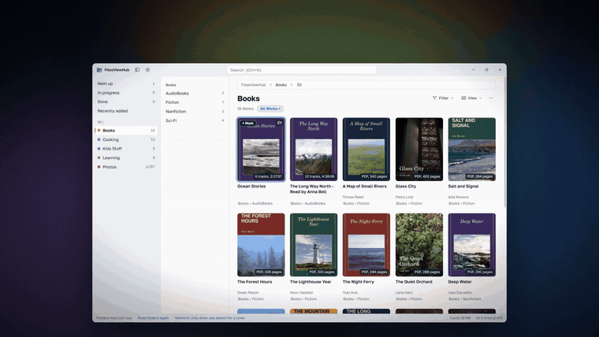
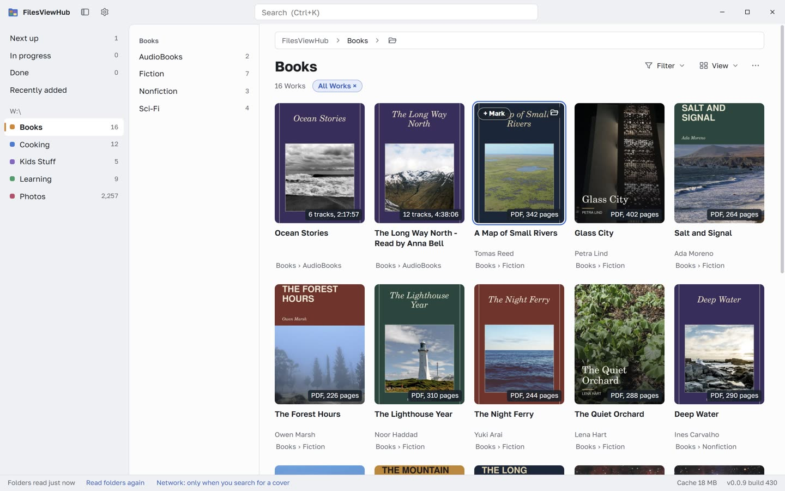
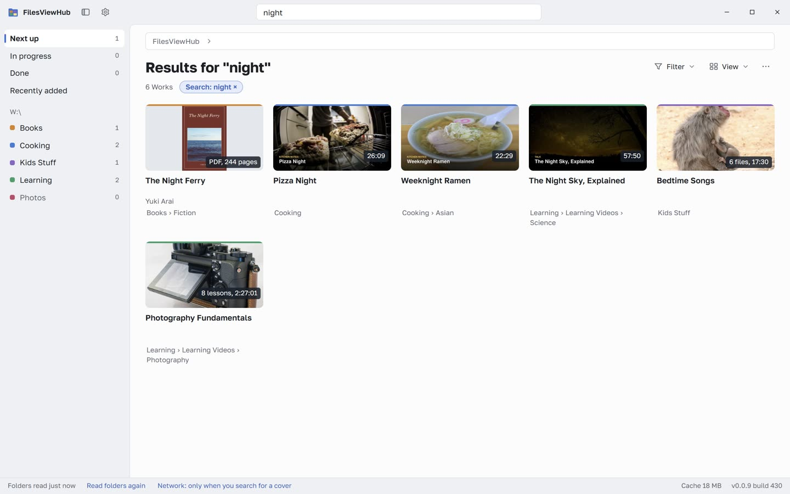
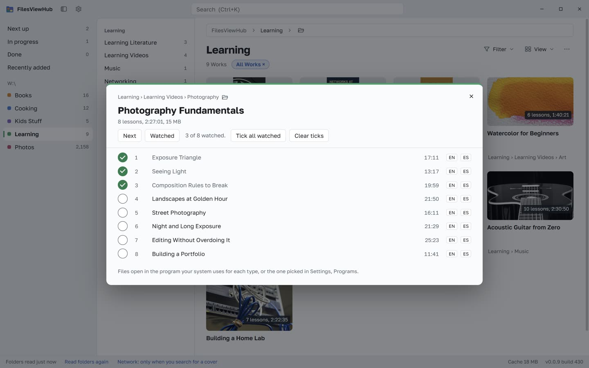
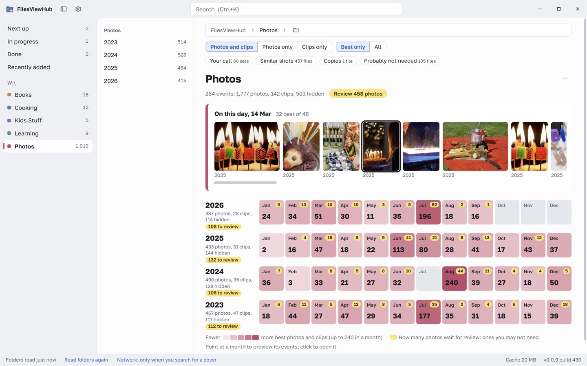
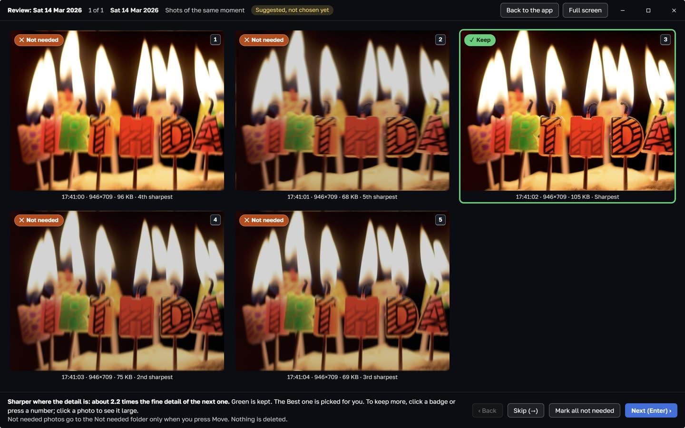
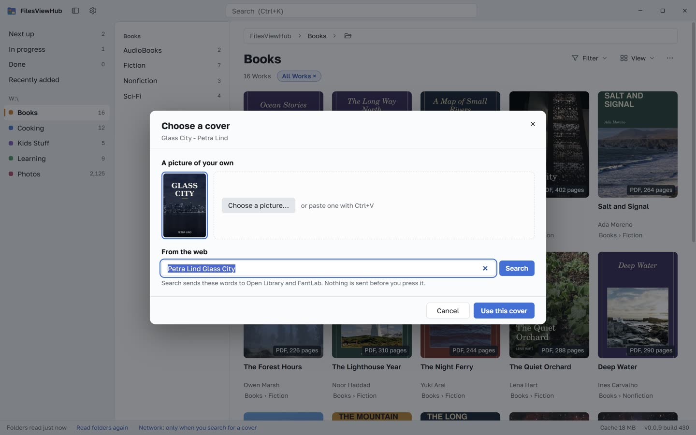
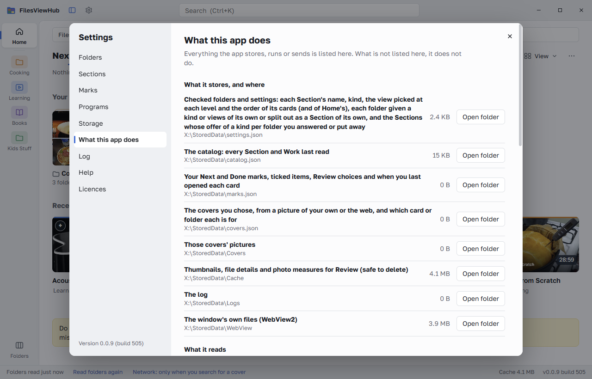

  

<h1 align="center">FilesViewHub</h1>

  <strong>Your folders of courses, books, videos and photos, as one catalog you can browse.</strong> 
  Tick the folders on any drive. FilesViewHub shows each course, book, album and video as a card
  with its cover, lets you search all of them at once, and remembers what is next and what is done.
  It never changes your files.

  
  
  

  <a href="https://github.com/fallenfuzz/filesviewhub/releases/latest"><strong>Download</strong></a> ·
  <a href="#quick-start">Quick start</a> ·
  <a href="../README.md">User guide</a> ·
  <a href="../CONTRIBUTING.md">Contributing</a> ·
  <a href="https://github.com/fallenfuzz/filesviewhub/issues">Issues</a>

  

  

  Every picture here is from the real app, showing a made-up library.

---

## What it does

### Folders become cards

Each folder you tick is a Section, and its kind decides what becomes a card: a course with its
lessons, a book in all its formats, an album or activity pack, a single video, or a day of photos.
The app guesses the kind from what is inside, and you can change it, for a Section or for any
folder in it.

### Covers it finds by itself

A card's picture comes from the files: a frame of the video, the first page of a PDF or DjVu, the
cover inside an EPUB, a comic or an audio file, the preview an Office file saved. A card shows how
long its videos and tracks run and how many pages its book has.

### Search everything at once

  

One search box covers every Section. Filters narrow the results to videos, books and documents,
or audio.

### Next, In progress, Done

  

Mark a card Next or Done; tick the lessons or tracks you finished and the card shows how far you
are. Home lists what is next, what is in progress and what was added or opened lately. A backup of
your marks is one click in Settings.

### Photos by day, and a Review of the shots you do not need

  

A Photos Section groups pictures and clips into events by the day they were taken: a calendar of
years and months, On this day, and the days of each month.

  

Review finds shots of the same moment, copies saved again smaller, screenshots, very dark and
blurred photos, and suggests which to keep. You decide. Only when you press **Move** do the photos
you marked go into a `Not needed` folder, and **Undo** puts them back. Nothing is ever deleted.

### Covers from the web, only when you ask

  

For a book whose files hold no good cover, **Choose a cover…** takes a picture of your own, or
searches Open Library and FantLab with words you can edit. Nothing is sent until you press Search.

### Nothing hidden

  

**Settings, What this app does** lists everything the app stores, reads, runs and sends, with the
folder each file is in. The app reads your folders and never writes into them. Apart from one
connection WebView2 makes as it starts on Windows, it goes online only for a cover search. It keeps
its data in a `StoredData` folder next to itself, so it is portable and leaves nothing elsewhere.

## Quick start

**Windows 10 and 11**

1. Download `FilesViewHub-<version>-build-<n>-windows.zip` from
   [Releases](https://github.com/fallenfuzz/filesviewhub/releases/latest) and unzip it anywhere you
   can write, for example `Downloads`. Keep the `tools` folder next to `FilesViewHub.exe`.
2. Double-click `FilesViewHub.exe`. The app is not signed yet, so Windows may say "Windows protected
   your PC": click **More info**, then **Run anyway**.
3. Tick the folders you want to see and click **Save and read these folders**.

**Linux (x86_64)**

1. Download `FilesViewHub-<version>-build-<n>-linux-x86_64.AppImage`.
2. `chmod +x FilesViewHub-*.AppImage`, then run it. FFmpeg and PDFium are inside it.

macOS is next. The [user guide](../README.md), also in the app under **Settings, Help**, covers
everything else.

## Built with

[Tauri 2](https://tauri.app) with a Rust core and a [Svelte](https://svelte.dev) interface.
Thumbnails come from [FFmpeg](https://ffmpeg.org), [PDFium](https://pdfium.googlesource.com/pdfium/)
and [DjVuLibre](https://djvu.sourceforge.net), which ship in the package; **Settings, Licences**
lists every part and its licence.

## Contributing

Issues and pull requests are welcome. Start with [`CONTRIBUTING.md`](../CONTRIBUTING.md): setup, the
one command that checks a change (`node scripts/check.mjs`), and what review looks for. Decisions
and their reasons are in [`decisions/`](../decisions/README.md), the words the code uses in
[`docs/glossary.md`](../docs/glossary.md), and the guide for AI coding agents in
[`AGENTS.md`](../AGENTS.md). To report a security problem, see [`SECURITY.md`](../SECURITY.md).

## Licence

FilesViewHub is free software under the GNU General Public License, version 3 or later
([`LICENSE`](../LICENSE)). It comes with no warranty.
