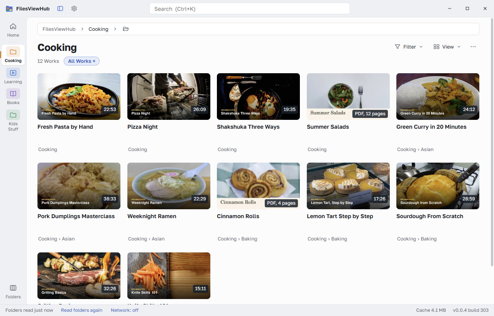

# FilesViewHub

FilesViewHub shows the folders you choose as a catalog of cards: courses, books, videos, photos,
activity packs and anything else, with thumbnails, search, and Next and Done marks. It reads your
folders and never changes or deletes anything in them. It moves files in one case only: photos you
set aside in Review, when you press **Move**, and **Undo** puts them back. It is an early test
version for Windows 10 and 11, with first try-out versions for Linux and for macOS 13 or later.

## Start it

### On Windows

1. Unzip the folder anywhere, for example into `Downloads`. Keep the `tools` folder next to
   `FilesViewHub.exe`: the app uses it to make thumbnails.
2. Double-click `FilesViewHub.exe`.
3. Windows may say "Windows protected your PC", because the app is not signed yet. Click
   **More info**, then **Run anyway**. Windows asks only the first time.
4. Tick the folders you want to see and click **Save and read these folders**.

Nothing is installed. The app keeps everything it saves in a `StoredData` folder next to
`FilesViewHub.exe`, so put it somewhere you can write, not in `Program Files`.

### On Linux

The Linux version is one file, `FilesViewHub-<version>-build-<n>-linux-x86_64.AppImage`, for
64-bit PCs. It is tried on Arch Linux and Ubuntu 24.04.

1. Put the file in a folder you can write, for example `~/Applications` or `Downloads`. The app
   keeps its `StoredData` folder next to it.
2. Make it runnable: `chmod +x FilesViewHub-*.AppImage`, or tick **Allow executing file as
   program** in its properties.
3. Start it. If it says FUSE is missing, see [Problems and fixes](#problems-and-fixes).
4. For DjVu thumbnails, install DjVuLibre (Arch: `sudo pacman -S djvulibre`). FFmpeg and PDFium
   are inside the AppImage.

The folder list shows **Home** first, then each drive your system has mounted (a USB stick,
a second disk, a network share), then **Computer**, the whole file system. A drive goes by its
label, or by where it is mounted when it has none. A drive keeps its checked folders when it is
mounted somewhere else next time.

Not there yet on Linux:

- **Settings**, **Programs** has no list of programs. Each file opens in the program your
  system uses for its type.

### On a Mac

There are two disk images: `FilesViewHub-<version>-build-<n>-macos-arm64.dmg` for a Mac with
Apple silicon (M1 and later) and `...-macos-x64.dmg` for an Intel Mac. They need macOS 13 or later.

1. Open the disk image and drag the `FilesViewHub` folder into **Applications** or **Documents**.
   The app keeps its `StoredData` folder next to `FilesViewHub.app`, inside that folder, so it
   cannot start from the disk image itself.
2. Double-click `FilesViewHub.app` in the folder you dragged.
3. The app is not signed yet, so macOS says it cannot check it. Click **Done**, open **System
   Settings**, **Privacy & Security**, and click **Open Anyway** at the bottom (on macOS 13 and 14:
   right-click the app, **Open**). macOS asks only the first time.
4. If the app then says it cannot write its StoredData folder, macOS is still running it from a
   read-only copy. Run this once in Terminal, then start it again:
   `xattr -dr com.apple.quarantine /Applications/FilesViewHub` (or the folder you chose).

### Update, back up, remove

- To update, unzip the new version over the old folder, or replace `FilesViewHub.exe` and the
  `tools` folder. On a Mac, replace `FilesViewHub.app`. Do not delete the old folder first: `StoredData` holds your marks.
- To back up your marks and settings, copy `StoredData`, or save a backup in **Settings**,
  **Marks** (see [Marks and backups](#marks-and-backups)).
- To remove the app and everything it saved, delete its folder.

## Find your way around

- The app opens on **Next up**: what you marked to do next. Click the app's name to come back
  to it. **In progress**, **Done**, **Recently added** and **Recently opened** are tabs beside it, and **Your
  folders** under it shows a tile for each folder you ticked. Until you mark something Next,
  Your folders come first, with a row of what was added last under them.
- The left column lists your drives and, under each, the folders you ticked. Each one is a
  Section. The next column shows the folders inside it. Point at a folder, a folder tile or a
  step of the address bar to see where it is on disk (both places for a Section on two drives).
  Drag a column's right edge to make it wider; double-click the edge to reset it.
- The sidebar button next to the app's name hides both columns; a narrow window hides them by
  itself. A thin bar on the left then holds **Home** and a button for each Section; **Folders**
  at its foot brings the columns back. They stay open while you click through folders, and
  close when you click **Folders** again, press Esc or click the cards.
- The address bar above the page shows where you are. Click a step to go back to it; click the
  arrow after a step to pick another Section or folder inside it. When the path is too long
  for the bar, its first steps fold into **…**; click it to go to one of them.
- A folder shows each subfolder as a row, then what it keeps itself. Click a row, or press
  Enter or Space on it, to open it in place: its folders as tiles, then its first 12 Works. Rows
  start closed, and each stays as you left it. **View** has **Expand all** and **Collapse all**,
  and so does a row's menu. The arrow button at a row's start opens that folder. With a filter
  on, only rows with a match show; a search lists every match without rows. **Show all** lists
  everything below the folder; **View** can make that the rule.
- **Filter**, right of the page title, shows only Videos, Books and documents or Audio, and
  only Works marked Next or Done. It works in any view and with search; while it is on, the
  button turns blue and names it, and the chip under the title turns it off.
- **View** changes the card size (Compact shows a list), the order of the cards (by name, date
  added or length, either way, kept for each Section and for Home) and whether files not on a
  card show in their folders. Where the page has subfolders, it also sets how they show: rows that open, folder tiles
  or everything below. At a Section's top that is the Section's view. Inside a folder it is that
  folder's own, and the folders below it take it until one has its own. **Same as**, first in
  that list, gives the folder again the view it takes from above: the nearest folder with its own,
  or the Section. A page with no subfolders,
  such as a Courses Section of courses or a folder of books, has only cards, so **View** offers
  no view there.
- Right-click a Section, a folder, a subfolder row, a folder tile, a card or the page title for
  what you can do with it: open it, show it in File Explorer, mark a card Next or Done, read a
  Section or folder again, make its thumbnails again, open the Section's settings or remove it
  from the app. The **⋯** button right of the page title opens the same menu for the page.
- Search finds every word you type, in any order, in titles, years, formats, lesson and track
  titles and folder names. In a folder it searches that folder; **Search everywhere** widens it.
- Click a card to open its file in the program Windows uses for that type, or the one picked
  in **Settings**, **Programs**. A book in several formats opens the first; the others are on
  its **Also** line. A course or an album opens the list of its lessons or tracks by folder,
  with their lengths, captions and handouts, each folder's time and how many you ticked, and
  **Continue** at the top for the first lesson you have not ticked; a folder of pictures or books shows them as a
  grid. Point at a card and the folder button in its picture's corner opens its folder in File
  Explorer. A program or script (`.exe`, `.bat`, `.js` and the like) is shown in File Explorer,
  never started.
- **Settings**, **Programs** lists every type of file in your folders by a plain name and its
  extension, for example "Subtitles (.srt)", and the program it opens in. A type with no program
  says **Not set**. **Change** offers the programs Windows offers for that type, Store apps
  included, with a tick on the current one, or **Other program** for any `.exe`. A program you
  picked that is no longer installed is marked **Not installed**. **View** shows the list as a
  table by kind or by program. More than three types outside video, audio, pictures and books
  fold under **Other types**.
- **Files not on a card** are files in your folders that the app made no card for: an archive,
  captions with no video, a script, a program's folder. Nothing is hidden: each is listed with
  the reason. Under the title of a Section or folder, **N files not on a card** lists those in
  it and in its folders below (a year or month in Photos is no folder, so it has none); its menu
  has the same item. **Files not on a card** at the foot of
  the left column lists them for every Section. A file in the list opens as a card would; its
  folder opens that folder. **View**, **Files not on a card: show in their folders** also lists
  them at the foot of each folder's page, in the dialog of the card whose folder holds them,
  and in search.
- **Read folders again** (bottom left) picks up files added since the app started. **Read this
  Section again** (or **Read this folder again**) in its menu reads only that Section or folder,
  and **Make its thumbnails again** remakes its thumbnails. **Settings**, **Storage** remakes all
  of them.
- **Settings** (the gear at the top left) changes the folders, renames a Section, changes how a
  Section makes cards, moves the cache, lists everything the app stores and does, and shows this
  help and the licences.

### Keys

| Keys | What they do |
| --- | --- |
| Ctrl+K or / | Go to the search box |
| Alt+Left, Alt+Right | Step back and forward through the views you saw (the mouse's back and forward buttons too) |
| Menu key or Shift+F10 | Open the menu of what has the focus |
| Arrow keys, Enter, Esc | Move through a menu, pick, close it |
| F1 | Open this help |
| Ctrl+Z | Undo, while a message with **Undo** shows |
| Ctrl+click, Shift+click | Select cards: one more, or every card up to this one |
| Ctrl+Space, Shift+Space | The same for the card that has the focus |
| Ctrl+A, Esc | Select every card on the page, clear the selection |

## Sections and their kinds

Each top-most folder you tick is a Section. Its kind decides what becomes a card. The app guesses
the kind from what is in the folder until you choose one.

| Kind | What becomes a card |
| --- | --- |
| **Courses** | A folder per course, lessons inside: one card for each course. |
| **Books and documents** | Each book; files with the same name in different formats are one card. |
| **Collections** | A folder full of files is one card, like an album or an activity pack. |
| **Videos and files** | Every file is its own card. |
| **Photos** | Pictures and clips by the day they were taken, in years and months (see [Photos and Review](#photos-and-review)). |

- **Section settings…**, in a Section's menu or as **Settings…** beside it in **Settings**,
  **Sections**, changes its name and its kind. On the right, made-up samples show how the kind
  picked looks at each level (the Section, inside a folder, one Work; for Photos all years, a
  year, a month, a day), in the views used now. **View** sets how a folder shows its subfolders. A new name is shown at
  once, with nothing read again. A new kind says how many cards it makes from your files; when
  you click **Save** the cards are made again, and a note says how many
  marked cards would change: their marks wait in **Settings**, **Marks**. **Undo** in the
  message at the bottom, or Ctrl+Z, puts it all back. **Let the app guess again** hands the kind
  back to the app.
- **Folder settings…**, in any folder's menu (right-click it in the columns, its row or tile, or
  its name in the address bar), gives one folder its own kind, for example a **Books**
  folder inside a Section of videos. It holds for that folder and every folder below it, until a
  deeper folder has its own. **Same as** (first in the kinds) takes what the
  folder above it has. The folder stays in its Section, and its cards keep the Section's name and
  colour. If you rename or move that folder on disk, it shows as its Section does again, and a
  message says so once. Give a folder of photos inside a Section the kind **Photos**, and from
  there down it shows as a Photos Section does: years, months, events and days, with **Review**
  and **Move** for that folder alone.
- **Make it a Section**, at the foot of **Folder settings…**, makes a folder at any depth a
  Section of its own, with the kind picked there and the views it shows: its own name, colour and place on
  the rail. Its cards move to it, so each card shows once, and their marks stay. The Section it
  came from shows the folder as a row or tile in the new Section's colour that opens it. A
  folder inside the new Section can be made a Section too. **Put back into…**, in the new
  Section's menu, makes it a folder again with its kind and views. If its folder is moved or
  renamed on disk, the Section says **not found**, as a ticked folder does.
- A **Photos** Section shows no folders, only years and months. Its **Section settings…** has a
  tab **Folders with other things** that lists the folders inside it. Give one a kind there, for
  example **Books and documents** for a folder of PDFs: its pictures leave the calendar, and the
  folder shows below the years in the first column, where it opens as folders do. **Make it a
  Section** on its line makes it a Section of its own, which shows there too.
- When some folders inside a Section look like another kind (a folder of photos in a Section of
  videos), the top of that Section says so once and lists them with the kind each looks like,
  and how many cards that makes and which marks it sets aside. **Set a kind per folder** gives
  each that kind, **Make each a Section** makes each a Section of its own, and **Keep one kind**
  puts the note away. The app never does either by itself, and the message that follows has
  **Undo**. **Suggest kinds for its folders**, at the foot of **Section settings…**, shows the
  note again.
- A Section on a second drive can show inside another (**Section settings…**, **Show
  inside**), for example two Books folders as one. A book on both drives is one card that says
  so, and it opens from whichever drive is connected.
- When a ticked folder is moved, renamed or deleted, its Section says **not found** and the
  bottom bar warns. Tick its new place in **Settings**, **Folders** and remove the old one;
  then move its marks over in **Settings**, **Marks**.

## Photos and Review

- A folder of photos from a phone or camera becomes a **Photos** Section (or pick that kind in
  its **Section settings…**). It opens on a calendar: a row per year, each month shaded by how
  many photos it holds (the legend under it says how), and **On this day** above it with photos
  from today's date in past years.
- Photos taken with no long gap between them are one event, dated from the file name or, if the
  name has no date, from the date the camera stored in the picture. A WhatsApp picture, whose
  name gives only the day, sits on that day with its time not known. **Settings**, **Sections**
  sets how long a gap starts a new event and which day starts the week.
- Point at a month to flip through its events; click it to see the month as a calendar, each day
  with its photos. Click a year to see its months in a strip and each month's events; click a month in the
  strip, or its name over its events, to see its calendar. Point at an event to flip through its
  photos. Click a day to see its photos in a panel on the right,
  and use the arrow keys to move to the next day with photos. While it is open the folder
  columns fold into the **Folders** strip on the left; click it to open them.
- Click a photo to see it full size. A photo that is one of a set of extra shots or copies
  opens **Review** at its set instead (see below). Click a clip to play it in your video player. While you
  look at photos full size, the arrow keys stop on a clip too and show a frame of it; press
  Enter to play it. Photos take no marks.
- At the top, choose **Photos and clips**, **Photos only** or **Clips only**, and **Best only**
  or **All**. **Best only** leaves out the extra shots of a moment (**+2** on the Best one shows
  them), copies and pictures you probably do not need; every count says how many are hidden.
  **Your call**, **Similar shots**, **Copies** and **Probably not needed** show only those.
  With **Photos only** or **Clips only**, **Review** and its counts cover that kind only.
  Every count is of files, never of events.

### Review

- In a Photos Section the app suggests photos you may not need: extra shots of the same moment
  (it picks the **Best one**, the sharpest) and copies of the same picture. Cards, months and
  years say how many wait. Screenshots, forwarded, blurred or very dark pictures are only
  labelled and listed under **Probably not needed**; they do not wait for Review.
- **Review** opens in its own window: move it, put it on another screen, maximise it, or press
  **Full screen** (F11; Esc leaves full screen). **Back to the app** puts it on the taskbar and
  shows the main window; click it on the taskbar to go on. It goes through them one set at a
  time, every photo of a set at once, in the order they were taken. One is always kept: the green frame and **Keep**; the others say **Not
  needed**. Under each photo: when it was taken, its size in pixels, its file size, and how sharp
  it is against the others (**Sharpest**, **2nd sharpest**...). When the shots look about the
  same it is **Your call**: the sharpest starts kept, and you change it if you like. Copies show
  the original beside them; when it is on another day (with its date) or in a set of shots, you
  choose it there, not with its copies.
- A copy of a photo in a set (sent on, or saved again) is shown in that set, so one moment is
  one step. When a set holds both photos from the camera and smaller copies without the camera's
  details (sent over WhatsApp or another messenger), each says **Original** or **Sent copy** in
  its lower corner. Two files of one picture taken at the same second (one of them edited) say
  **Same photo**, and a set that is all one picture says **One photo, saved more than once**.
- Click a photo's **Keep** or **Not needed** badge, or press its number (1 to 9, then 0 for the
  tenth; the key shows in its corner), to change it, then **Next** (Enter). **Next** needs one
  photo kept; to set a whole set aside, press **Mark all not needed**. **Skip** (the right arrow)
  and **Back** (the left arrow) only look: nothing is kept until you press **Next**, and the end
  says how many you skipped, with **Go through the skipped ones**.
- Click a photo, or press Space, to see it large, with the whole set in a strip below. The left
  and right arrows show the others, **K** keeps the one shown and **X** marks it Not needed, Esc
  goes back to all of them, and Enter is still **Next**.
- You can stop at any time: close Review (× or Esc) and your choices are kept. The next time,
  Review starts at the sets still waiting. To move what you have marked so far, press **Move N
  not needed now** at the top of Review; after the move, Review goes on with the sets still
  waiting.
- Click a photo that is in a set, or press Enter on it, to open **Review** of its day at that
  set. **Next** then goes on through the rest of the day. A set you chose before shows your
  choices; nothing changes until you press **Next**.
- **Move the Not needed photos** lists every photo marked Not needed in the photo folder, by
  month, each with its picture and folder, and says how many of them are in the month or year
  you opened it from. Untick a photo, or a whole month, to leave it where it is. The ticked
  ones move into a **Not needed** folder inside the photo folder, or a folder you choose
  outside your ticked folders. Nothing is deleted: on the same
  drive each photo is renamed into place, on another drive it is copied, checked, and only then
  removed from where it was. **Undo this move** puts them back, and they wait for Review
  again. A photo only in the cloud stays where it is.
- To change your mind about one photo, right-click it (in the day, On this day or Review) and
  pick **Review again**, or press **Review again** in the viewer. Your choice for it is
  forgotten, so it waits for Review again; the other photos of its set keep theirs. A photo
  Review does not suggest, such as a Best one, is then simply kept. The message that follows
  has **Undo**.
- If the folder you choose is outside your Dropbox or OneDrive folder, the app warns you: to
  Dropbox or OneDrive the move is a delete, so the photos go from your other devices too. Look
  through the folder and empty it when you are sure.
- To read the steps first, **Save as a script instead** saves a script for the ticked photos, which you run yourself (on
  Windows: right-click it, **Run with PowerShell**).

## Marks and backups

- The **+** badge in a card's top corner marks it (it reads **+ Mark** when you point at the
  card): click once for **Next** (you want to do it), again for **Done**, a third time to clear it.
- To mark many cards at once, select them as in File Explorer (Ctrl+click, Shift+click or
  Ctrl+A), right-click one of them and pick **Mark 10 Done** (or Next, or Clear). One **Undo**
  puts them all back.
- In a course, an album or any folder card, tick each lesson or file you have done. The card
  shows a bar for how far you are. Ticking them all offers **Done**; it never sets it for you.
- **In progress** lists the courses, albums and books where you ticked some lessons, tracks or
  titles but have not marked Done yet, the one you ticked last first.
- **Recently opened** lists the cards whose files you opened from the app, the last one first.
  To empty it, click **…** at the right of the tabs, then **Clear this list**. **View**, **Sort
  by**, **Last opened** puts any folder's cards in that order.
- **Settings**, **Marks** saves your marks to a backup file and adds them back from one, for
  example on another PC.
- After you rename or move a folder, its mark is left behind. The bottom bar then says how many
  marks are orphaned. **Settings**, **Marks** shows them and moves each one to the card you pick.

## What it reads and never changes

- It reads names, sizes and dates of the files in the folders you ticked, and never changes the
  files it reads.
- It makes a thumbnail for each card in the background, from a picture in the folder, a book's
  cover, a document's first page or a few frames of a video (point across a video's picture to
  step through them). The status bar shows how many are left. It also reads how long each video
  and track is and how many pages a PDF has.
- It never downloads a Dropbox or OneDrive file that is only in the cloud. Such a file gets no
  thumbnail until it is on your PC. When you open one, the app first tells you its size and
  that Dropbox or OneDrive will download it to your PC, and opens it only if you say yes. A
  folder on a network drive is read over your network, as File Explorer reads it.
- To give a card or a folder tile a different cover, right-click it and choose **Choose a
  cover…**. Pick a picture file with **Choose a picture…**, or paste one with Ctrl+V, or look on
  the web: change the search words if you like and press **Search** to see covers from Open
  Library and FantLab. Click one and press **Use this cover**. The cover stays after a restart.
  **Remove this cover** in the same place goes back to the cover the files give; on a cover from
  the web, the globe on its card offers **Not this cover** too.
- It goes online only when you press **Search** in **Choose a cover…**: it sends the search
  words to Open Library and FantLab, fetches the small pictures of the covers they found, and
  fetches in full only the one you use. Nothing is fetched by itself. Every request is written
  to `network.log` in the log folder. On Windows its window is
  drawn by Microsoft WebView2, which the app starts with every web address blocked; WebView2
  itself may still open one connection to Microsoft as it starts. On a Mac and on Linux the window
  is WebKit, which the app cannot block the same way; which connections WebKit opens is not
  checked yet.
- It saves its settings, catalog, marks, the covers you chose and a log in `StoredData` next to `FilesViewHub.exe`,
  and thumbnails in the `Cache` folder inside it. **Settings**, **Storage** can move the cache
  to a `FilesViewHub Cache` folder inside one you choose, never into a folder you ticked. It
  writes nowhere else on your PC, except a marks backup where you save it and the photos you
  move in Review. Each move is written down in `StoredData\moves.json` first, which is what
  **Undo** reads.
- **Settings**, **What this app does** lists all of this, with the programs in the `tools`
  folder (FFmpeg, PDFium, DjVuLibre) that make thumbnails.

## Problems and fixes

- **Windows says "File not found" when you save a backup in Documents.** Windows' ransomware
  protection is blocking the app there. Save in another folder, such as `Downloads`, or in
  Windows Security, **Ransomware protection**, **Allow an app through Controlled folder
  access**, add `FilesViewHub.exe`.
- **A video in MKV or TS will not play inside the app.** It opens in your video player instead.
- **On Linux, it says FUSE is missing.** Install `fuse2` (Arch: `sudo pacman -S fuse2`), or start
  it with `--appimage-extract-and-run`.
- **On Linux, the window stays empty** (seen with some NVIDIA drivers). Start it with
  `WEBKIT_DISABLE_DMABUF_RENDERER=1 ./FilesViewHub-*.AppImage`.
- **On Linux, emoji in folder or file names show as empty boxes.** Install an emoji font (Arch:
  `sudo pacman -S noto-fonts-emoji`).

### Sending a problem

Open **Settings**, then **Log**, to see what the app did: each start, the folders it read, the
files you opened and anything that went wrong. **Problems only** shows just the warnings and
errors; click a path to open it in File Explorer. Click **Copy log** and paste it into your
message along with what you did and what you saw.

## Licences

FilesViewHub is free software: you can share it and change it under the GNU General Public
License, version 3 or later (`LICENSE.txt`). It comes with no warranty.

The programs in the `tools` folder and the parts built into the app each have their own licence.
**Settings**, **Licences** lists every one with its version, its licence texts and where its
source is. `THIRD-PARTY-NOTICES.txt` holds the same list: in the app folder on Windows and on a
Mac, inside the AppImage on Linux. DjVuLibre and jbigkit are under the GPL, so on Windows their
exact source is in `tools/djvulibre/source`; on a Mac DjVuLibre's is in
`FilesViewHub.app/Contents/Resources/tools/djvulibre/source`, with that of the libjpeg built into
it. The Linux AppImage carries FilesViewHub's own source,
since a library under the GPL is loaded into the app there.
